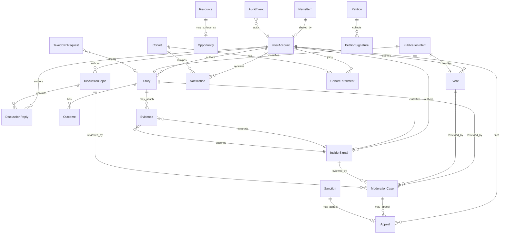
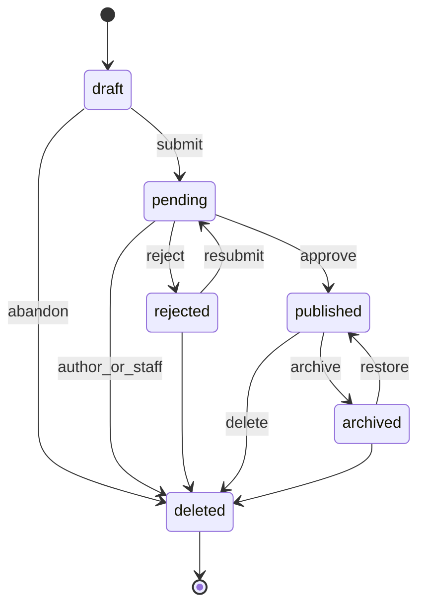

# Domain Contract v1 — aitookmyjob complete product

**Version:** `1.0.0`  
**Machine-readable source of truth:** [`lib/domain-contract.js`](../lib/domain-contract.js)  
**Bead:** `aitj-z8q.1`  
**Status:** Canonical for product-v1 schema and feature work. Free-form status strings are **forbidden** for new code.

This document defines ownership, privacy, retention, lifecycle state machines, API boundaries, and deletion invariants. Feature schemas must import enums from the machine-readable contract — they must not invent parallel status vocabularies.

---

## 1. Design principles

1. **Enums only** — every lifecycle `status` field is drawn from a frozen enum for that entity. Unknown strings are invalid.
2. **Publication intent first** — user expression is classified by intent (`vent`, `story`, …) before content type details.
3. **Privacy is explicit** — visibility and field-level display redaction are first-class, not inferred from status.
4. **Evidence is never public** — raw evidence has restricted access; public surfaces show verification level only.
5. **Soft delete → purge** — user-facing deletion is soft; hard purge follows retention timers unless legal hold applies.
6. **PostgreSQL in production** — no production feature may depend on browser localStorage or local JSON files as durable store.

---

## 2. Entity catalog

| Entity | Owner | Privacy / visibility (default) | Retention | Notes |
|--------|--------|--------------------------------|-----------|--------|
| **PublicationIntent** | Author (or anonymous session) | Controls on child content | Same as child content | Not always a separate row; required metadata on vents/stories/signals |
| **Story** | Author user or anonymous | Public feed after publish, field-masked | Soft-delete 30d → purge; legal hold blocks purge | Structured displacement narrative |
| **Vent** | Author | Often community/private; author-chosen | Author retention choice (30/90/365/indefinite) then soft-delete → purge | Lightweight expression; not forced into “action” content |
| **InsiderSignal** | Author (restricted) | Public: summary + verification only | Soft-delete 30d → purge; legal hold | Company-linked automation/displacement signal |
| **Evidence** | Uploader; access = author + privileged roles | **Never public** | After parent closed/deleted: 90d → purge (unless legal hold) | Files/docs linked to signals or stories |
| **NewsItem** | System / editor | Public when published | Published retained; rejected discoverable 30d then purge | Ingested or shared news |
| **DiscussionTopic** | Author | Public when published | Soft-delete 30d → purge | Forum topics |
| **DiscussionReply** | Author | Public when published | Soft-delete 14d → purge | Forum posts |
| **Resource** | Curator / system | Public when published | Archived retained; deleted 30d → purge | Reskilling, legal, jobs links |
| **Opportunity** | Curator / author | Public when open | Closed 180d → archive; deleted 30d → purge | Jobs/transition opportunities (distinct from generic resource) |
| **Cohort** | Facilitator / system | Public discovery; roster restricted | Completed 365d metadata retain; PII roster purge 90d after leave/complete | Groups, enrollment, events |
| **Notification** | System → recipient | Private to recipient | 90d after delivered/read → purge | In-app / email / telegram hooks |
| **ModerationCase** | Moderators / system | Restricted (staff) | Closed cases 2y audit retain | Queue over stories, vents, topics, signals, reports |
| **Appeal** | Appellant | Restricted (appellant + staff) | Closed 2y audit retain | Challenge of moderation or sanction |
| **Outcome** | Story/vent author | Same visibility as parent (masked) | Tied to parent retention | Job-search / pivot follow-up state |
| **UserAccount** | Subject user | Private profile; public display via content privacy | Account delete: PII purge; content anonymize or purge per rules | Auth + identity |
| **Sanction** | Staff | Restricted | Active + 2y after expiry | warn / mute / suspend / ban |
| **TakedownRequest** | Requester / legal | Restricted | Closed 3y legal retain | Legal/content removal requests |
| **Petition** | Author / system | Public when open | Closed retained; deleted soft 30d | Campaign signatures |
| **AuditEvent** | System | System-only (admin export redacted) | 2y minimum | Action log; no raw evidence bodies |

### 2.1 Ownership rules (testable)

- **O1.** Only the owner (or staff with moderator+ role) may edit content body while status is `draft` or `pending`.
- **O2.** Anonymous content has `submittedBy = null`; ownership actions require tracking code or staff.
- **O3.** Moderators may change status along allowed transitions; they may not change `publicationIntent` after first non-draft state without audit.
- **O4.** Evidence owner is the uploader; staff with `admin`/`superadmin` or assigned legal role may access under audit.

---

## 3. Publication intents and desired-response controls

### 3.1 Intent enum (`PUBLICATION_INTENT`)

| Intent | Purpose | Primary entity | Default desired response |
|--------|---------|----------------|--------------------------|
| `vent` | Emotional release / being heard | Vent | `empathy` |
| `story` | Structured displacement narrative | Story | `witness` |
| `advice_request` | Ask for practical advice | Story or Vent (flagged) | `advice` |
| `warn` | Warn others about employer/practice | Story or InsiderSignal | `share` |
| `good_news` | Share recovery / rehire / pivot success | Story | `celebrate` |
| `news_share` | Share an external news item + commentary | NewsItem (+ optional comment) | `discuss` |

### 3.2 Desired response (`DESIRED_RESPONSE`)

Frozen set: `none` | `empathy` | `advice` | `witness` | `share` | `celebrate` | `discuss` | `practical_help`

UI and notifications must respect author choice (e.g. `none` / `empathy` must not force “call to action” prompts).

### 3.3 Author controls (required on publishable expression)

| Control | Enum / type | Notes |
|---------|-------------|--------|
| `anonymityMode` | `identified` \| `alias` \| `anonymous` | Maps into field display privacy |
| `desiredResponse` | `DESIRED_RESPONSE` | Default from intent |
| `advicePermission` | `open` \| `followers` \| `closed` | Who may give advice |
| `visibility` | `VISIBILITY` | Content audience |
| `retentionPreference` | `RETENTION_PREFERENCE` | Especially for vents |

### 3.4 Field-level display privacy (existing product language)

| Control | Values |
|---------|--------|
| `nameDisplay` | `alias` \| `initials` \| `first_name` \| `anonymous` |
| `companyDisplay` | `exact` \| `industry_only` \| `masked` |
| `geoDisplay` | `city` \| `region` \| `country` \| `hidden` |
| `dateDisplay` | `exact` \| `month` \| `year` \| `hidden` |

---

## 4. Visibility levels (`VISIBILITY`)

| Level | Who can read content body |
|-------|---------------------------|
| `public` | Anyone (incl. logged-out) |
| `community` | Authenticated users |
| `restricted` | Author + moderators/admins (+ legal when applicable) |
| `private` | Author only (+ system for delivery) |
| `system` | No end-user UI; staff tools only |

**Invariants:**

- **V1.** `Evidence` max visibility is `restricted` (never `public` or `community`).
- **V2.** Public story/vent APIs must apply field-level privacy masking before response.
- **V3.** Aggregates used for research may include only published + non-deleted content and must not reverse-identify authors below cohort thresholds (implementation: min cell size policy outside this contract).
- **V4.** Insider signal **public** surface is summary + `verificationLevel` only; raw fields that re-identify stay `restricted`.

---

## 5. Lifecycle state machines

All transitions are **directed**. Same-state no-ops are allowed in helpers but should not write audit noise. Terminal hard state after purge is absence of row (not a status).

### 5.1 Story (`STORY_STATUS`)

```
draft ──► pending ──► published ──► archived
  │          │            │
  │          ▼            ▼
  │       rejected      deleted
  │          │            │
  └──────────┴──► deleted
                  archived ──► deleted
```

| From | To |
|------|-----|
| `draft` | `pending`, `deleted` |
| `pending` | `published`, `rejected`, `deleted` |
| `published` | `archived`, `deleted` |
| `rejected` | `pending` (resubmit), `deleted` |
| `archived` | `published` (restore), `deleted` |
| `deleted` | *(none — purge is offline job)* |

**Legacy runtime today:** `pending` | `published` | `rejected` only (see §10).

### 5.2 Vent (`VENT_STATUS`)

| From | To |
|------|-----|
| `draft` | `pending`, `deleted` |
| `pending` | `published`, `rejected`, `deleted` |
| `published` | `hidden`, `deleted` |
| `hidden` | `published`, `deleted` |
| `rejected` | `pending`, `deleted` |
| `deleted` | — |

### 5.3 Insider signal (`INSIDER_SIGNAL_STATUS`)

| From | To |
|------|-----|
| `draft` | `submitted`, `deleted` |
| `submitted` | `under_review`, `deleted` |
| `under_review` | `published_summary`, `rejected`, `legal_hold` |
| `published_summary` | `legal_hold`, `deleted` |
| `rejected` | `under_review`, `deleted` |
| `legal_hold` | `under_review`, `published_summary` (staff only; no delete while hold) |
| `deleted` | — |

**Verification level** (orthogonal to status): `uncorroborated` | `single_source` | `multi_source` | `verified`.

### 5.4 Evidence (`EVIDENCE_STATUS`)

| From | To |
|------|-----|
| `uploaded` | `scanning`, `purged` |
| `scanning` | `available`, `restricted`, `purged` |
| `available` | `restricted`, `redacted`, `purged` |
| `restricted` | `available` (staff), `redacted`, `purged` |
| `redacted` | `purged` |
| `purged` | — |

### 5.5 News (`NEWS_STATUS`)

| From | To |
|------|-----|
| `discovered` | `pending`, `rejected` |
| `pending` | `published`, `rejected` |
| `published` | `archived` |
| `archived` | `published` |
| `rejected` | `pending` |

**Legacy runtime today:** mostly `published` only.

### 5.6 Discussion topic (`DISCUSSION_TOPIC_STATUS`)

| From | To |
|------|-----|
| `pending` | `published`, `rejected`, `deleted` |
| `published` | `locked`, `deleted` |
| `locked` | `published`, `deleted` |
| `rejected` | `pending`, `deleted` |
| `deleted` | — |

**Legacy runtime today:** `published` | `pending` | `deleted` (replies often start as `published`).

### 5.7 Discussion reply (`DISCUSSION_REPLY_STATUS`)

| From | To |
|------|-----|
| `pending` | `published`, `deleted` |
| `published` | `deleted` |
| `deleted` | — |

### 5.8 Resource (`RESOURCE_STATUS`)

`draft` → `published` → `archived` → `deleted`; `published` → `deleted`; `draft` → `deleted`.

### 5.9 Opportunity (`OPPORTUNITY_STATUS`)

`draft` → `open` → `closed` → `archived`; `open` → `deleted`; `closed` → `deleted`; `draft` → `deleted`.

### 5.10 Cohort (`COHORT_STATUS`)

| From | To |
|------|-----|
| `draft` | `open`, `cancelled` |
| `open` | `full`, `in_progress`, `cancelled` |
| `full` | `open` (capacity free), `in_progress`, `cancelled` |
| `in_progress` | `completed`, `cancelled` |
| `completed` | — |
| `cancelled` | — |

**Legacy runtime today:** `open` only.

### 5.11 Notification (`NOTIFICATION_STATUS`)

`pending` → `delivered` → `read`; `pending` → `failed` | `cancelled`; `failed` → `pending` (retry); `delivered` → `cancelled` (n/a hide).

### 5.12 Moderation case (`MODERATION_STATUS`)

`open` → `in_review` → `approved` | `rejected` | `escalated`; `escalated` → `in_review` | `approved` | `rejected`; terminal `closed` from approved/rejected.

Staff actions on content map to content transitions (`approve` ⇒ content `published`, `reject` ⇒ content `rejected`).

### 5.13 Appeal (`APPEAL_STATUS`)

`submitted` → `under_review` → `upheld` | `overturned`; `submitted` → `withdrawn`; `under_review` → `withdrawn`.

### 5.14 Outcome (`OUTCOME_STATUS`)

Author follow-up on a story/vent (orthogonal metrics like `foundNewJob` map here):

| Status | Meaning |
|--------|---------|
| `searching` | Still looking |
| `found` | Found new work |
| `pivoted` | Changed field / reskilled |
| `left_workforce` | Left workforce temporarily/permanently |
| `unknown` | No update |

Transitions: any non-terminal outcome may move to any other (author update). Not a strict linear machine.

### 5.15 Supporting enums

- **Sanction type:** `warn` | `mute` | `suspend` | `ban`
- **Takedown:** `pending` | `in_review` | `accepted` | `rejected` | `completed`
- **Petition:** `draft` | `open` | `closed` | `deleted`
- **Evidence tier (story confidence):** `self_report` | `doc_verified` | `multi_source`
- **Anonymous inbox:** `received` | `triaged` | `linked` | `closed`

---

## 6. Relationship diagram





*Story lifecycle (representative).*

---

## 7. API boundaries

Routes **own** entity writes. Cross-entity reads are allowed; cross-entity writes go through the owner module or shared storage helpers with contract enums.

| Surface | Module | Entities owned |
|---------|--------|----------------|
| `/api/auth/*` | `routes/auth.js` | UserAccount, identity, session, account deletion |
| `/api/stories/*`, `/api/stats`, `/api/companies/*`, counters, sitemap | `routes/stories.js` | Story, Outcome (story), company board topics (derived), story metrics |
| `/api/forum/*` | `routes/forum.js` | DiscussionTopic, DiscussionReply |
| `/api/admin/*` | `routes/admin.js` | ModerationCase actions, Sanctions, admin news ingest trigger |
| `/api/resources`, `/api/news`, cohorts, petitions, digest, privacy tools, takedown, anonymous inbox, telegram | `routes/integrations.js` | Resource, NewsItem, Cohort, Petition, Notification(subscribe), TakedownRequest, AnonymousInbox |
| `/api/meta`, `/api/locale`, `/health`, `/api/activity`, `/api/events` | `server.js` | Meta only (no durable domain writes) |
| Storage / schema | `lib/context.js`, `lib/storage.js`, future migrations | Persistence; must store contract statuses |

### 7.1 Planned API ownership (product-v1, not all implemented)

| Entity | Planned prefix | Notes |
|--------|----------------|-------|
| Vent | `/api/vents` | Distinct from stories |
| InsiderSignal | `/api/signals` or `/api/insider-signals` | |
| Evidence | `/api/evidence` (upload/access under auth) | Never public list |
| Appeal | `/api/appeals` + admin resolve | |
| Opportunity | `/api/opportunities` | May start under resources |
| Notification | `/api/notifications` | User inbox |
| Outcome | nested `POST /api/stories/:id/outcome` | Prefer over free `foundNewJob` boolean long-term |

### 7.2 Boundary rules

- **B1.** Public GET list endpoints return only statuses in that entity’s **public-visible set** (e.g. stories: `published` only).
- **B2.** Moderation transitions for content run through admin moderation routes (or dedicated service), not arbitrary client status PATCH.
- **B3.** Deletion of user account is owned by auth; cascade logic must satisfy §8.
- **B4.** News ingest writes only `NEWS_STATUS` values.

---

## 8. Privacy and deletion invariants (testable)

These statements are encoded as pure functions / data in `lib/domain-contract.js` and asserted in tests.

### 8.1 Privacy

1. **P-EVIDENCE-PUBLIC:** `isPubliclyListable('evidence', anyStatus) === false`.
2. **P-VIS-EVIDENCE:** For entity `evidence`, allowed visibility ⊆ `{ restricted, private, system }`.
3. **P-STORY-PUBLIC-STATUS:** Public story feeds include only `published`.
4. **P-SIGNAL-PUBLIC:** Public insider signal payloads must not include evidence blob fields; verification level only.
5. **P-MASK:** Field display privacy enums are closed sets; unknown values are invalid.
6. **P-NOTIFY:** Notification bodies are `private` to recipient; not listable on public APIs.

### 8.2 Deletion & cascade

1. **D-SOFT:** User/content “delete” sets status `deleted` (or `purged` for evidence) — does not hard-remove until retention elapses, except when policy says anonymize-in-place.
2. **D-USER-CASCADE:** On account delete:
   - Anonymize or soft-delete owned stories, vents, signals, topics, replies.
   - Purge or detach PII (email, phone, telegram link).
   - Cancel pending notifications to that user.
   - Retain audit rows with actor id redacted or pseudonymized per policy.
   - Evidence: mark `purged` schedule; do not leave downloadable blobs.
3. **D-STORY-CASCADE:** Story → `deleted` implies: child outcomes hidden; evidence scheduled purge; moderation cases closed; appeals remain for audit but target marked deleted.
4. **D-SIGNAL-CASCADE:** InsiderSignal delete schedules all linked evidence for purge unless `legal_hold` on parent or evidence.
5. **D-LEGAL-HOLD:** While status is `legal_hold`, transition to `deleted` is **forbidden**.
6. **D-RETENTION:** `getRetentionRule(entity)` returns structured `{ softDeleteDays, purgeDays, legalHoldBlocksPurge }`.
7. **D-NO-PUBLIC-DELETED:** `isPubliclyListable(entity, 'deleted') === false` for all entities that have `deleted`.

### 8.3 Status integrity

1. **S-CLOSED:** `assertValidStatus(entity, status)` throws/returns false for free-form strings.
2. **S-TRANSITION:** `canTransition(entity, from, to)` is the only allowed mutation graph for lifecycle fields.
3. **S-MODMAP:** Moderation action `approve`|`reject` maps to concrete content statuses via contract helpers (not ad-hoc strings in new code).

---

## 9. Retention rules (structured)

| Entity | softDeleteDays | purgeDays (after soft delete) | Notes |
|--------|----------------|-------------------------------|--------|
| story | 0 (immediate soft) | 30 | legal hold blocks |
| vent | 0 | per preference (30/90/365) or 30 default | indefinite = no auto purge until account delete |
| insider_signal | 0 | 30 | legal hold blocks |
| evidence | 0 | 90 | legal hold blocks |
| discussion_topic | 0 | 30 | |
| discussion_reply | 0 | 14 | |
| news | n/a for published | rejected: 30 | |
| notification | n/a | 90 from terminal | |
| moderation_case | n/a | 730 (2y) retain closed | |
| appeal | n/a | 730 | |
| audit_event | n/a | 730 minimum | |
| cohort roster PII | leave/complete | 90 | cohort metadata longer |

---

## 10. Gaps vs existing runtime code

| Area | Current code | Contract v1 | Action for later beads |
|------|--------------|-------------|------------------------|
| Story status | `pending`, `published`, `rejected` | + `draft`, `archived`, `deleted` | Add columns/usage when expression flows ship |
| Forum topics | `published`, `pending`, `deleted` | + `locked`, `rejected` | Align on lock/reject |
| Forum replies | often `published` only | `pending` \| `published` \| `deleted` | Optional pre-mod |
| News | `published` | full machine | Ingest may use `discovered`/`pending` |
| Cohorts | `open` | full machine | `aitj-z8q.14` |
| Petitions | `open`, `deleted` | + `draft`, `closed` | |
| Takedown | `pending` | full legal machine | |
| Vents / intents / appeals / opportunities / notifications inbox | missing or stub | defined here | `aitj-z8q.8`, `.9`, `.15`, etc. |
| Outcome | boolean `foundNewJob` + filter `found`/`searching` | enum `OUTCOME_STATUS` | Map boolean ↔ enum in transition layer |
| Account delete | `storageDeleteUser` — cascade depth unclear | D-USER-CASCADE | Harden in privacy bead |
| Status validation | free `TEXT` in Postgres | contract helpers | Wire asserts at write boundaries gradually |

**Legacy story status map (valid subset):** `pending` → `STORY_STATUS.PENDING`, `published` → `PUBLISHED`, `rejected` → `REJECTED`.

---

## 11. Versioning

- Constant: `DOMAIN_CONTRACT_VERSION = '1.0.0'`.
- Breaking enum renames or transition removals require `v2` document + version bump.
- Additive statuses need a minor bump and migration notes.

---

## 12. Implementation entry points

```js
const domain = require('../lib/domain-contract');
// domain.DOMAIN_CONTRACT_VERSION
// domain.STORY_STATUS, domain.canTransition('story', from, to)
// domain.assertValidStatus('story', status)
// domain.PRIVACY_INVARIANTS, domain.DELETION_CASCADES, domain.RETENTION_RULES
```

Re-exported from `lib/schemas.js` for discoverability next to Zod input schemas.

---

## 13. TL product decisions (2026-07-19)

Resolved for product-v1 so feature beads are not blocked on open questions:

1. **Outcome model** — Keep dual boolean (`foundNewJob`) ↔ `OUTCOME_STATUS` mapping until `aitj-z8q.8` lands full Outcome entity writes. New code must write enum; readers may still accept boolean.
2. **Vent vs Story storage** — Separate entities and API boundaries (`/api/vents` vs `/api/stories`). Shared expression traits (intent, privacy, retention) are metadata, not a single polymorphic table requirement.
3. **Account delete of published content** — Prefer **anonymize** published stories that feed aggregates; soft-delete then purge only when author retention preference / legal path requires it (see D-USER-CASCADE).
4. **Public vents** — Default visibility for vents is **`community`**. Public vents allowed only when author explicitly sets `visibility: public`; search (`aitj-z8q.17`) must respect this.
5. **Runtime enforcement** — Contract helpers are available now; write-path `assertValidStatus` / `assertCanTransition` land in feature PRs (not a separate hard-block bead).

## 14. Codex acceptance checklist

- [x] Versioned architecture document (`docs/domain-contract-v1.md`)
- [x] Entity list with ownership, privacy, retention
- [x] Lifecycle enums + transitions (not free-form)
- [x] API boundaries table
- [x] Privacy/deletion invariants stated as testable rules
- [x] Publication intents + desired-response controls
- [x] Relationship diagrams (mermaid)
- [x] Machine-readable module + tests
- [x] TL product decisions recorded (§13)
- [ ] Codex formal approval (gate `aitj-z8q.20`)
